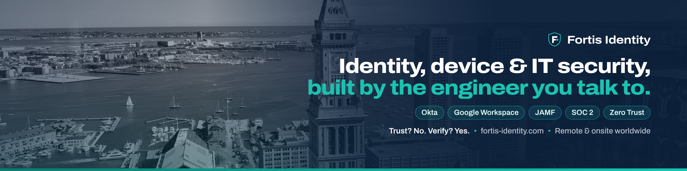

# Fortis Identity Solutions

**Identity Access Management, Device Posture and IT Security for teams that need it most.**

Fortis Identity is an engineer-led security consultancy. You work directly with a senior security engineer (in IT since 2017), not an account manager or a ticket queue. We deliver the frameworks, hardening and documentation your team keeps, at a fixed price agreed before any work starts.

> **Trust? No. Verify? Yes.**

## What we do

| Area | What it looks like |
| --- | --- |
| 🔐 **Identity & Access (IAM)** | Okta and Google Workspace SSO, MFA enforcement, lifecycle automation, SCIM provisioning |
| 💻 **Device Posture** | JAMF and Kandji zero-touch Mac deployment with Apple Business Manager, baseline hardening, device trust |
| 🛡️ **Zero Trust** | Current-state audits and identity-first access models mapped to NIST 800-207 |
| ✅ **Compliance Readiness** | SOC 2 access controls, access reviews and audit evidence, alongside Vanta, Drata or your auditor |
| 🔄 **Onboarding & Offboarding** | Automatic account creation, same-day access removal, PowerShell automation and runbooks |

## Frameworks we build to

`NIST CSF` · `NIST 800-207 Zero Trust` · `CIS Benchmarks` · `SOC 2` · `ISO 27001`

## Stack

`Okta` · `Google Workspace` · `Microsoft 365` · `JAMF Pro` · `Kandji` · `Apple Business Manager` · `SCIM` · `PowerShell` · `Vanta` · `Drata`

## How an engagement works

1. **Free 20-minute call** with the engineer who would do the work
2. **Written scope** with a fixed price and timeline
3. **The work**, remote or onsite, with progress updates
4. **Handoff** with runbooks and a walkthrough so your team can run it

Remote or onsite, anywhere in the US and worldwide.

## Get in touch

🌐 [fortis-identity.com](https://www.fortis-identity.com) · 📦 [Packages & pricing](https://www.fortis-identity.com/#packages) · ✉️ [info@fortis-identity.com](mailto:info@fortis-identity.com)

Found a security issue in something we publish? See our [security contact](https://www.fortis-identity.com/.well-known/security.txt).
